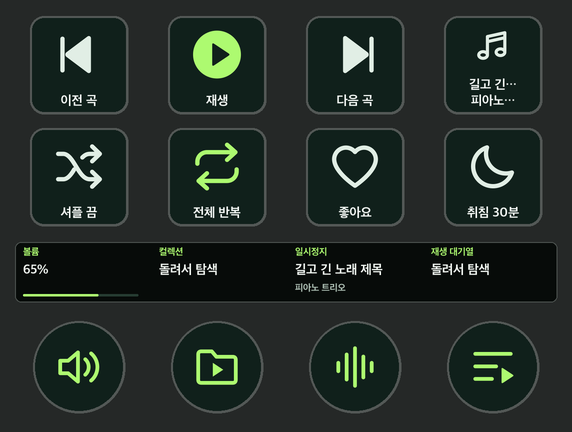

# Stream Deck +용 melon 플러그인

Mac에서 실행 중인 멜론의 볼륨, 재생 상태, 재생목록을 Stream Deck +로 조작합니다. 앨범 커버와 곡명을 터치 영역에 표시하며, 좋아요, 플레이리스트에 담기, 저장된 검색, 취침 타이머도 지원합니다. 개인이 개발한 비공식 플러그인입니다.



## 설치

1. macOS 13 이상에서 멜론 Mac 플레이어와 Stream Deck 7.1 이상을 설치해 주세요.
2. GitHub 릴리스에서 `local.melon.deck.streamDeckPlugin`을 내려받아 두 번 클릭해 주세요. [릴리스 및 설치 파일](https://github.com/andrew427dev/streamdeck-melon/releases)
3. Stream Deck에서 **멜론 Plus** 프로필을 선택해 주세요. 목록에 보이지 않으면 같은 릴리스의 `melon-plus.streamDeckProfile`을 열어 주세요.
4. 멜론 기본모드를 열어 주세요. 연결 확인에서 권한 안내가 뜨면 macOS **시스템 설정 → 개인정보 보호 및 보안 → 손쉬운 사용**에서 Stream Deck을 허용해 주세요.

세 번째 다이얼을 돌리면 멜론 볼륨이 기본 5%씩 바뀝니다. 한 번 눌러 재생하거나 멈추고, 두 번 눌러 다음 곡으로, 세 번 눌러 이전 곡으로 이동합니다. 네 번째 다이얼은 대기열을 탐색하며, 누르거나 터치해 선택한 곡을 재생합니다. [전체 조작법과 지원 범위](사용안내.md)

## 개발

Xcode Command Line Tools와 Node.js 22 이상을 사용합니다. 저장소 루트에서 다음 명령을 실행해 주세요.

```sh
npm ci
npm test
npm run build
```

빌드는 Swift 소스에서 Apple Silicon 및 Intel용 실행 파일을 만들고, 테스트를 실행한 뒤 저장소 루트에 `local.melon.deck.streamDeckPlugin`을 생성합니다. GitHub Actions에서도 푸시와 풀 리퀘스트마다 macOS 빌드와 패키지 검사를 실행합니다.

플러그인의 키·다이얼 이벤트 처리는 [deck.mjs](local.melon.deck.sdPlugin/bin/deck.mjs), 멜론 Mac 앱 조작은 [MelonBridge.swift](native/MelonBridge.swift)에서 확인하실 수 있습니다.
